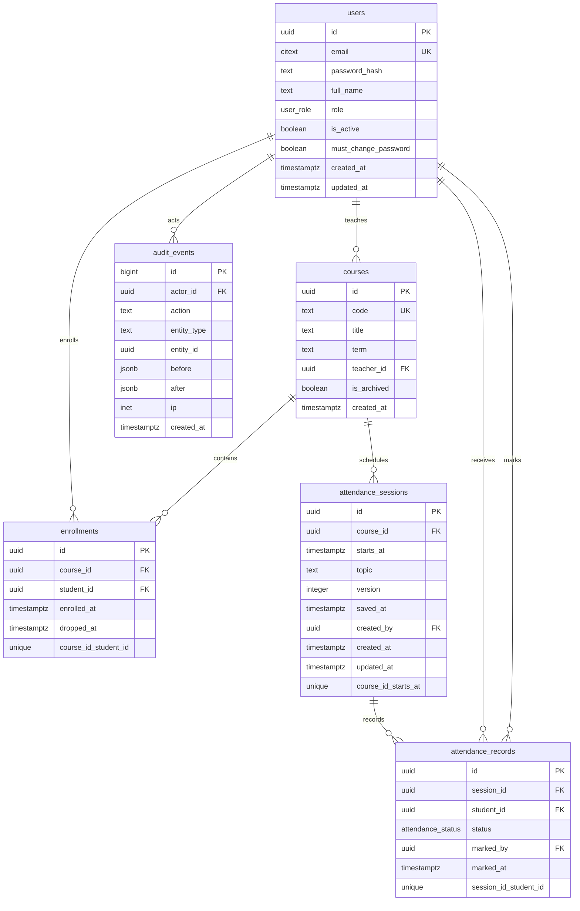

# Database Design — Supabase Primary and Read Replica

**Parent design:** [`design.md`](./design.md)
**Status:** Design contract. No migrations have been created yet.

## 1. Topology

```text
                    writes, transactions, login lookups, edit forms
Browser ──> API ──────────────────────────────────────────────> Supabase Primary (master)
                                                                    │
                                                                    │ asynchronous streaming replication
                                                                    ▼
                    lists, histories, reports                    Supabase Read Replica (slave)
Browser ──> API ──────────────────────────────────────────────> (read-only)
```

- **Primary (master):** the only writable database. Supabase Postgres in an AWS region.
- **Read Replica (slave):** a Supabase Read Replica in the same region as the primary.
- The replica is **read-only**, **asynchronous**, and **not an automatic failover target**.
- Each database has its own connection endpoint and pooler string.
- The application uses ordinary PostgreSQL through Drizzle, not the Supabase Data API.

### Supabase Read Replica requirements

- Pro, Team, or Enterprise plan.
- AWS-hosted project.
- Small compute or larger.
- PostgreSQL 15 or newer.
- Read Replica compute is billed separately and is not covered by the Supabase spend cap.

### Setup order

1. Create the primary project in the institution's nearest region.
2. Enable a Read Replica in the same region.
3. Wait for the replica status to become available.
4. Copy the primary pooler URL and the replica pooler URL from the Supabase Connect panel.
5. Create application roles and grants.
6. Run migrations on the primary.
7. Confirm the replica is streaming and the read role can query it.

## 2. Entity Relationship Diagram



## 3. Enums

```sql
CREATE TYPE user_role AS ENUM ('admin', 'teacher', 'student');
CREATE TYPE attendance_status AS ENUM ('present', 'absent');
```

`present` and `absent` are the only attendance states. “Late” and “excused” are out of scope for v1.

## 4. Schema DDL

Run these migrations on the **primary only**.

```sql
CREATE EXTENSION IF NOT EXISTS citext;
CREATE EXTENSION IF NOT EXISTS pgcrypto;

CREATE TABLE users (
  id             uuid PRIMARY KEY DEFAULT gen_random_uuid(),
  email          citext NOT NULL UNIQUE,
  password_hash  text NOT NULL,
  full_name      text NOT NULL,
  role           user_role NOT NULL,
  is_active      boolean NOT NULL DEFAULT true,
  must_change_password boolean NOT NULL DEFAULT true,
  created_at     timestamptz NOT NULL DEFAULT now(),
  updated_at     timestamptz NOT NULL DEFAULT now(),
  CONSTRAINT users_full_name_not_blank CHECK (length(btrim(full_name)) > 0)
);

CREATE TABLE courses (
  id           uuid PRIMARY KEY DEFAULT gen_random_uuid(),
  code         text NOT NULL UNIQUE,
  title        text NOT NULL,
  term         text NOT NULL,
  teacher_id   uuid NOT NULL REFERENCES users(id) ON DELETE RESTRICT,
  is_archived  boolean NOT NULL DEFAULT false,
  created_at   timestamptz NOT NULL DEFAULT now(),
  CONSTRAINT courses_code_not_blank CHECK (length(btrim(code)) > 0),
  CONSTRAINT courses_title_not_blank CHECK (length(btrim(title)) > 0)
);

CREATE TABLE enrollments (
  id          uuid PRIMARY KEY DEFAULT gen_random_uuid(),
  course_id   uuid NOT NULL REFERENCES courses(id) ON DELETE CASCADE,
  student_id  uuid NOT NULL REFERENCES users(id) ON DELETE RESTRICT,
  enrolled_at timestamptz NOT NULL DEFAULT now(),
  dropped_at  timestamptz,
  CONSTRAINT enrollments_drop_after_enroll
    CHECK (dropped_at IS NULL OR dropped_at >= enrolled_at),
  CONSTRAINT enrollments_course_student_unique
    UNIQUE (course_id, student_id)
);

CREATE TABLE attendance_sessions (
  id          uuid PRIMARY KEY DEFAULT gen_random_uuid(),
  course_id   uuid NOT NULL REFERENCES courses(id) ON DELETE CASCADE,
  starts_at   timestamptz NOT NULL,
  topic       text,
  version     integer NOT NULL DEFAULT 1 CHECK (version >= 1),
  saved_at    timestamptz,
  created_by  uuid NOT NULL REFERENCES users(id) ON DELETE RESTRICT,
  created_at  timestamptz NOT NULL DEFAULT now(),
  updated_at  timestamptz NOT NULL DEFAULT now(),
  CONSTRAINT attendance_sessions_course_start_unique
    UNIQUE (course_id, starts_at)
);

CREATE TABLE attendance_records (
  id          uuid PRIMARY KEY DEFAULT gen_random_uuid(),
  session_id  uuid NOT NULL REFERENCES attendance_sessions(id) ON DELETE CASCADE,
  student_id  uuid NOT NULL REFERENCES users(id) ON DELETE RESTRICT,
  status      attendance_status NOT NULL,
  marked_by   uuid NOT NULL REFERENCES users(id) ON DELETE RESTRICT,
  marked_at   timestamptz NOT NULL DEFAULT now(),
  CONSTRAINT attendance_records_session_student_unique
    UNIQUE (session_id, student_id)
);

CREATE TABLE audit_events (
  id          bigserial PRIMARY KEY,
  actor_id    uuid REFERENCES users(id) ON DELETE SET NULL,
  action      text NOT NULL,
  entity_type text NOT NULL,
  entity_id   uuid,
  before      jsonb,
  after       jsonb,
  ip          inet,
  created_at  timestamptz NOT NULL DEFAULT now()
);
```

### Notes on columns

- `users.email` is `citext`, so email uniqueness is case-insensitive.
- `users` are never hard-deleted. Deactivation sets `is_active = false`.
- New accounts and admin password resets set `must_change_password = true`; the user must change the temporary password before using the app.
- `courses.teacher_id` must reference a user with role `teacher`; the application enforces this before insert/update.
- `enrollments.student_id` must reference a user with role `student`; the application enforces this.
- One enrollment row exists per student/course. Dropping sets `dropped_at`; re-enrollment clears `dropped_at` and resets `enrolled_at` (v1 does not preserve multiple enrollment windows).
- `attendance_sessions.saved_at` distinguishes a created draft from a saved register. Reports count only saved sessions.
- `attendance_sessions.version` starts at 1 and increments on every successful attendance save.
- `attendance_records` are created only for the roster that was enrolled at `starts_at`; every enrolled student must have exactly one record when a session is saved.
- `audit_events` is append-only. `entity_id` is intentionally not a foreign key because it is polymorphic.

## 5. Indexes

```sql
CREATE INDEX users_role_active_idx
  ON users (role, is_active);

CREATE INDEX courses_teacher_idx
  ON courses (teacher_id);

CREATE INDEX courses_term_archived_idx
  ON courses (term, is_archived);

CREATE INDEX enrollments_student_idx
  ON enrollments (student_id);

CREATE INDEX attendance_sessions_course_start_idx
  ON attendance_sessions (course_id, starts_at DESC);

CREATE INDEX attendance_sessions_saved_idx
  ON attendance_sessions (course_id, starts_at DESC)
  WHERE saved_at IS NOT NULL;

CREATE INDEX attendance_records_student_status_idx
  ON attendance_records (student_id, status);

CREATE INDEX audit_events_created_idx
  ON audit_events (created_at DESC);

CREATE INDEX audit_events_entity_idx
  ON audit_events (entity_type, entity_id);
```

The unique constraints already cover:

- `users (email)`
- `courses (code)`
- `enrollments (course_id, student_id)`
- `attendance_sessions (course_id, starts_at)`
- `attendance_records (session_id, student_id)`

## 6. Primary/Replica Routing

| Operation | Client | Target |
|---|---|---|
| Login user lookup | `writeDb` | Primary |
| Create/update/delete any row | `writeDb` | Primary |
| Attendance save transaction | `writeDb` | Primary |
| Session detail for editing | `writeDb` | Primary |
| Course list/detail | `readDb` | Replica |
| Roster | `readDb` | Replica |
| Session list/history | `readDb` | Replica |
| Student attendance history | `readDb` | Replica |
| Course report | `readDb` | Replica |
| Admin user/course lists | `readDb` | Replica |
| Audit log view | `readDb` | Replica |

Rules:

1. Never write through `readDb`.
2. Never use the replica for authentication, authorization, edit-form versions, or mutation responses.
3. Include `dataAsOf` in report responses and `X-Data-Source` / `X-Replica-Lag-Ms` headers on replica reads.
4. If the replica throws a connection or timeout error, retry once, then use `writeDb` with a 30-second circuit breaker. Emit a metric and never silently hide the fallback.
5. If replica lag exceeds 60 seconds, route non-report reads to the primary and show a degraded-read notice.

## 7. Attendance Save Transaction

The request includes the client's expected `version` and one record per enrolled student:

```json
{
  "version": 4,
  "records": [
    { "studentId": "uuid", "status": "present" },
    { "studentId": "uuid", "status": "absent" }
  ]
}
```

Validation before the transaction:

- Session exists and belongs to a course owned by the teacher.
- Every student in the payload is in the roster for `starts_at`.
- No duplicate `studentId`.
- Every roster student appears exactly once.
- Every status is `present` or `absent`.
- No client-supplied `marked_by`; use the authenticated teacher's ID.

Transaction:

```sql
BEGIN;

UPDATE attendance_sessions
SET version = version + 1,
    saved_at = COALESCE(saved_at, now()),
    updated_at = now()
WHERE id = $1
  AND version = $2
RETURNING id, course_id, version, saved_at;

-- If no row is returned: ROLLBACK and return 409 with the current version.

INSERT INTO attendance_records (session_id, student_id, status, marked_by, marked_at)
VALUES
  ($1, $2, $3, $4, now()),
  ($1, $5, $6, $4, now())
ON CONFLICT (session_id, student_id)
DO UPDATE SET
  status = EXCLUDED.status,
  marked_by = EXCLUDED.marked_by,
  marked_at = now();

INSERT INTO audit_events (actor_id, action, entity_type, entity_id, before, after, ip)
VALUES ($4, 'attendance.saved', 'attendance_session', $1, $5::jsonb, $6::jsonb, $7);

COMMIT;
```

Why this is safe:

- The `UPDATE ... WHERE version = ?` takes a row lock. Two devices with the same version cannot both succeed.
- The loser gets no row and returns `409`, so it cannot overwrite the winner.
- The version increment, record upserts, and audit insert are one transaction.
- The API returns the canonical session from the primary, so the UI never needs to read a lagging replica after a save.

The session roster at `starts_at` is:

```sql
SELECT e.student_id
FROM enrollments e
WHERE e.course_id = $1
  AND e.enrolled_at <= $2
  AND (e.dropped_at IS NULL OR e.dropped_at > $2);
```

## 8. Report Query

Reports read only saved sessions. The enrollment window determines which sessions count for each student.

```sql
WITH saved_sessions AS (
  SELECT s.id, s.course_id, s.starts_at
  FROM attendance_sessions s
  WHERE s.course_id = $1
    AND s.saved_at IS NOT NULL
),
roster AS (
  SELECT e.student_id, e.enrolled_at, e.dropped_at
  FROM enrollments e
  WHERE e.course_id = $1
),
counted AS (
  SELECT r.student_id, ss.id AS session_id
  FROM roster r
  JOIN saved_sessions ss
    ON ss.starts_at >= r.enrolled_at
   AND (r.dropped_at IS NULL OR ss.starts_at < r.dropped_at)
)
SELECT
  u.id,
  u.full_name,
  COUNT(c.session_id) AS total_sessions,
  COUNT(ar.id) FILTER (WHERE ar.status = 'present') AS present_sessions,
  CASE
    WHEN COUNT(c.session_id) = 0 THEN NULL
    ELSE ROUND(
      100.0 * COUNT(ar.id) FILTER (WHERE ar.status = 'present')
      / COUNT(c.session_id),
      1
    )
  END AS attendance_percent
FROM counted c
JOIN users u ON u.id = c.student_id
LEFT JOIN attendance_records ar
  ON ar.session_id = c.session_id
 AND ar.student_id = c.student_id
GROUP BY u.id, u.full_name
ORDER BY u.full_name;
```

A missing record on a saved session is treated as not present (it lowers the percentage) and should be investigated as an integrity error. The save path prevents it by requiring a complete roster.

## 9. Supabase Read Replica Behavior

### What replicates

- Tables, indexes, and DDL applied to the primary.
- Data changes through asynchronous streaming replication.
- Application settings managed through the Supabase dashboard.

### What does not use the replica

- Supabase Auth, Storage, and Realtime do not use the Read Replica.
- This application does not use those services; it uses Auth.js and direct Postgres.
- The Supabase Data API can only issue `GET` requests to a Read Replica. The app does not rely on the Data API.

### Replication lag

- Replication is asynchronous, so a replica is always potentially behind.
- Check lag on the replica:

```sql
SELECT
  now() AS replica_now,
  pg_last_xact_replay_timestamp() AS last_replay,
  EXTRACT(EPOCH FROM (now() - pg_last_xact_replay_timestamp())) AS lag_seconds;
```

- Check the primary's replication view:

```sql
SELECT pid, application_name, state, sent_lsn, write_lsn, flush_lsn, replay_lsn
FROM pg_stat_replication;
```

- Long-running transactions on the primary increase lag. Keep attendance transactions short and set a statement timeout on API queries.
- Alert above 10 seconds for two minutes; fail over reads to the primary above 60 seconds.

### Availability and failover

- A Read Replica is read-only. It is **not** an automatic failover target and is not promoted by this application.
- If the primary is down, writes and login return `503`. Reads may continue from the replica if it is available.
- Primary recovery and restoration are Supabase operations.
- During a primary restart or compute resize, the primary restarts first; replicas remain available during that period and restart after the primary is ready.
- Do not describe the Read Replica as a backup or a standby that accepts writes.

## 10. Connection Pooling

Supabase runs Supavisor in front of Postgres. Use the right endpoint for each workload:

| Workload | Endpoint | Settings |
|---|---|---|
| Serverless app writes | Primary transaction pooler, port `6543` | `prepare: false`, `max: 1`, SSL |
| Serverless app replica reads | Read Replica dedicated pooler | `prepare: false`, `max: 1`, SSL |
| Migrations and dumps | Direct connection or session pooler, port `5432` | No transaction pooling; SSL |

Application-side rules:

- Create the database client once at module scope, not per request.
- Set the Postgres.js pool to `max: 1` in serverless functions.
- Set `prepare: false`; the shared transaction pooler does not support prepared statements.
- Do not use session state, temporary tables, session advisory locks, or cursors outside a transaction through the transaction pooler.
- Postgres.js pipelines queries by default; avoid pipelining through the shared transaction pooler.
- Use `sslmode=verify-full` with Supabase's root certificate where possible. `sslmode=require` encrypts but does not verify the server.
- Use the dedicated pooler when available on the plan; it supports prepared statements, but this design keeps `prepare: false` for portability.

Example client shape (not yet implemented):

```ts
import postgres from "postgres";
import { drizzle } from "drizzle-orm/postgres-js";

const writeClient = postgres(process.env.DATABASE_URL!, {
  max: 1,
  prepare: false,
  ssl: "require",
});

const readClient = postgres(process.env.DATABASE_REPLICA_URL!, {
  max: 1,
  prepare: false,
  ssl: "require",
});

export const writeDb = drizzle(writeClient);
export const readDb = drizzle(readClient);
```

## 11. Database Roles

Use least-privilege roles. Passwords are set through the Supabase dashboard or secret manager, never committed.

```sql
-- Run as the Supabase postgres role.
CREATE ROLE app_write LOGIN;
CREATE ROLE app_read LOGIN;

GRANT USAGE ON SCHEMA public TO app_write, app_read;

GRANT SELECT, INSERT, UPDATE, DELETE
  ON ALL TABLES IN SCHEMA public
  TO app_write;

GRANT USAGE, SELECT
  ON ALL SEQUENCES IN SCHEMA public
  TO app_write;

GRANT SELECT
  ON ALL TABLES IN SCHEMA public
  TO app_read;

ALTER DEFAULT PRIVILEGES IN SCHEMA public
  GRANT SELECT, INSERT, UPDATE, DELETE ON TABLES TO app_write;

ALTER DEFAULT PRIVILEGES IN SCHEMA public
  GRANT USAGE, SELECT ON SEQUENCES TO app_write;

ALTER DEFAULT PRIVILEGES IN SCHEMA public
  GRANT SELECT ON TABLES TO app_read;
```

- `app_write` is used only with the primary URL.
- `app_read` is used only with the replica URL.
- The migration job uses the Supabase `postgres` role through `MIGRATION_DATABASE_URL`; the application never receives that URL.
- If the shared pooler is used for a custom role, its username is `[ROLE].[PROJECT-REF]`; copy the exact string from the Supabase Connect panel.
- Verify that the custom read role has `SELECT` access on the Read Replica after it is created. If the replica does not inherit a custom role grant, apply the grants through the Supabase SQL editor for the replica.

## 12. Row-Level Security and Data API

This application uses server-side Drizzle over a direct Postgres connection. It does not expose table access to the browser.

- Disable the Supabase Data API for this project unless a future feature explicitly needs it.
- Do not rely on RLS as the only authorization layer. The server service layer checks roles and relationships on every query.
- If the Data API is enabled later:
  - Enable RLS on every exposed table.
  - Add deny-by-default policies.
  - Test each role against each table.
  - Remember that the service role bypasses RLS; never ship it to the browser.
- Keep the database password and service-role key out of `NEXT_PUBLIC_*` variables.

## 13. Migrations and Seeds

- Use Drizzle Kit to generate SQL migrations.
- Commit generated migrations; review them before applying.
- Run migrations with `MIGRATION_DATABASE_URL` against the primary only.
- Use expand/contract for breaking changes.
- Never run migrations on application startup or on the read replica.
- Seed only a development/staging database: one admin, sample teachers/students/courses, and sample sessions.
- Do not seed production with a default password.

## 14. Backups, Retention, and Restore

- Supabase Pro daily backups are retained for 7 days; Team for 14 days; Enterprise up to 30 days.
- PITR is an optional add-on with a recovery point objective measured in minutes.
- The Read Replica is not a backup.
- Test restore into a separate Supabase project before relying on the procedure.
- Recommended retention:
  - Attendance and audit data: institution policy, default 5 years.
  - Audit events: at least 1 year.
  - Backups: at least 14 days for a production deployment.
- Deleting a Supabase project permanently removes its data and backups. Do not delete the project as part of a reset.

## 15. References

- Supabase Read Replicas: https://supabase.com/docs/guides/platform/read-replicas
- Getting started with Read Replicas: https://supabase.com/docs/guides/platform/read-replicas/getting-started
- Connecting to Postgres: https://supabase.com/docs/guides/database/connecting-to-postgres
- Serverless drivers: https://supabase.com/docs/guides/database/connecting-to-postgres/serverless-drivers
- Drizzle quickstart: https://supabase.com/docs/guides/database/drizzle
- Postgres.js quickstart: https://supabase.com/docs/guides/database/postgres-js
- Backups: https://supabase.com/docs/guides/platform/backups
- Read Replica usage and billing: https://supabase.com/docs/guides/platform/manage-your-usage/read-replicas
- Supabase pricing: https://supabase.com/pricing
