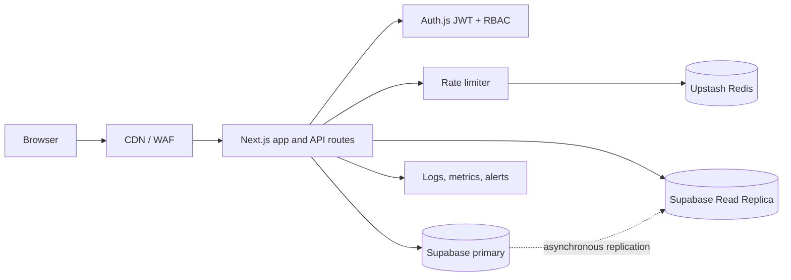
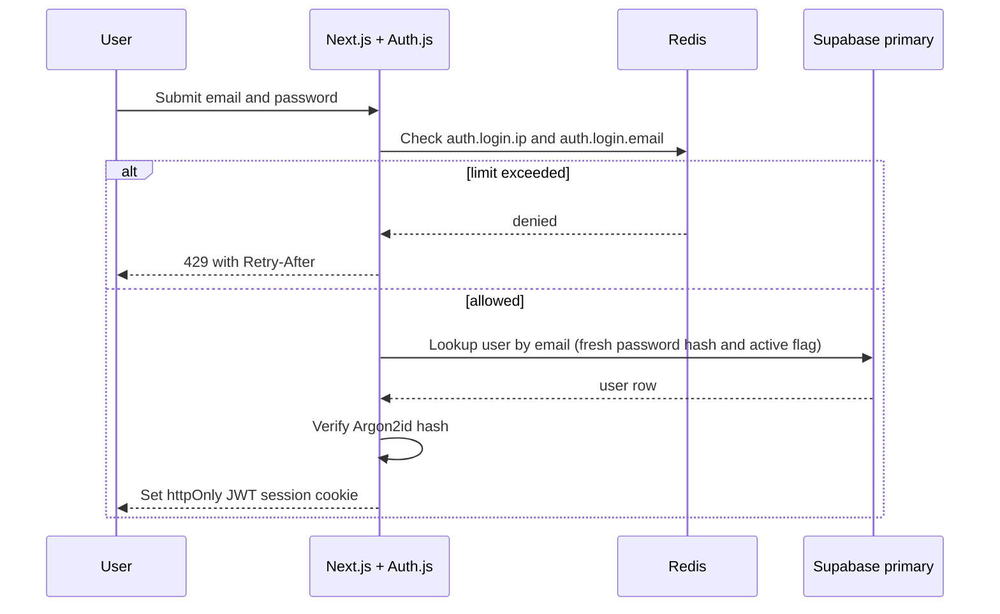
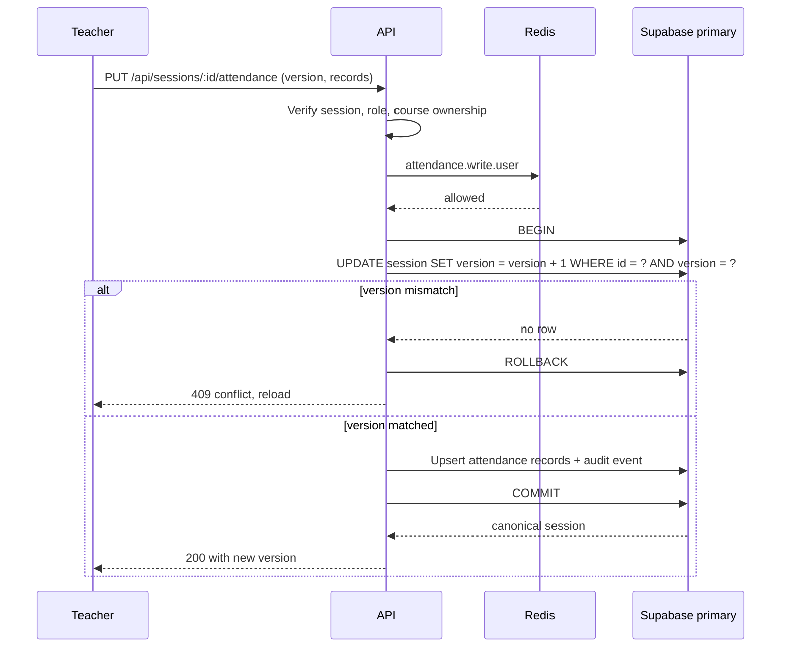
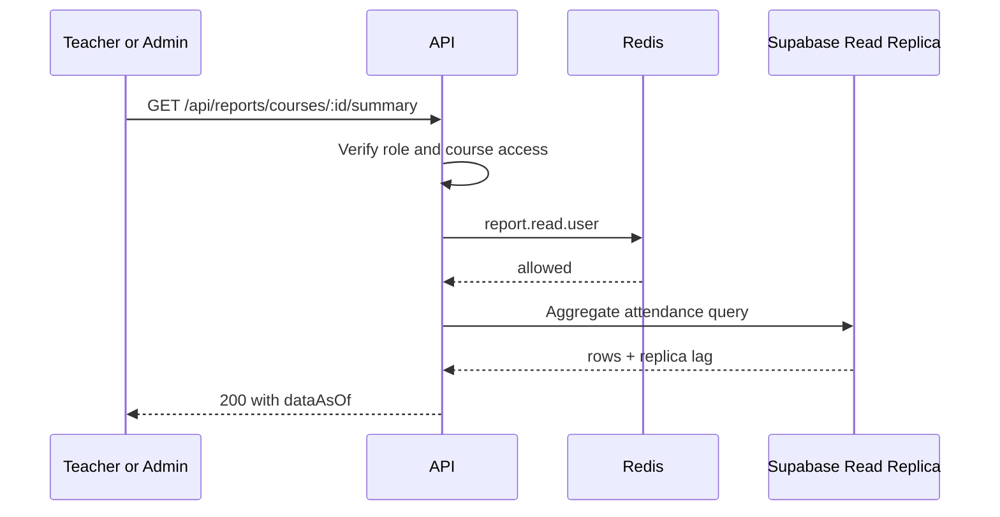
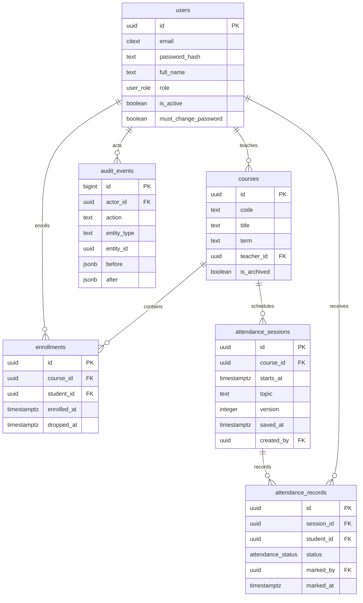

# Cloud-Based Student Attendance Management System — System Design

**Status:** Design complete. Application code has not been scaffolded.
**Audience:** Contributors, reviewers, and future implementation agents.

## 1. Overview

A cloud-hosted attendance system for one institution. Admins manage users, courses, and enrollments. Teachers take a manual present/absent roll call for their courses. Students view their own attendance. Reports are read from a PostgreSQL read replica while all writes go to the Supabase primary.

The design deliberately separates write and read paths:

- **Master / primary:** Supabase Postgres primary. Owns every write and every consistency-sensitive read.
- **Slave / read replica:** Supabase Read Replica. Serves course lists, rosters, histories, and reports. It is asynchronous, read-only, and **not** a failover target.

## 2. Goals and Non-Goals

### Goals

- Replace paper or spreadsheet roll call with a shared, cloud-backed register.
- Give admins a single place to manage people, courses, and enrollments.
- Let teachers mark attendance quickly on laptop or phone and see live totals.
- Let students check their own attendance without exposing other students' records.
- Keep the primary database focused on writes; use the replica for read-heavy reporting.
- Protect login, writes, and reports with server-side rate limits.
- Provide a calm, accessible white/black/blue interface.
- Document the architecture and rules well enough to implement without re-deciding them.

### Non-goals

- **Public signup.** Accounts are provisioned by an admin; a school controls its roster.
- **Parent portal.** Not needed for the first release.
- **QR, biometric, or self check-in.** Attendance is entered by a teacher. This avoids proxy check-ins and hardware dependencies.
- **Offline mode.** The system is cloud-first; the browser keeps unsaved marks only during a network failure.
- **Multi-tenant SaaS.** One institution per deployment.
- **Native mobile apps.** The responsive web app covers phones and tablets.
- **Notifications and CSV export.** Useful later, but not part of this design.
- **Automatic failover using the read replica.** Supabase Read Replicas are read-only; they are not promoted.

## 3. Users and Permissions

| Capability | Admin | Teacher | Student |
|---|---|---|---|
| Manage users | Yes | No | No |
| Manage courses and enrollments | Yes | No | No |
| View assigned/own courses | All | Own courses | Enrolled only |
| Create attendance sessions | Yes | Own courses | No |
| Mark attendance | No (view/audit only) | Own courses | No |
| View course reports | All | Own courses | No |
| View own attendance | Yes (any student) | Own courses | Own record only |
| View audit log | Yes | No | No |

Authorization is enforced in the server service layer, not only in the UI. Every query is scoped by the authenticated user's role and relationships.

## 4. Architecture

| Component | Single responsibility |
|---|---|
| CDN/WAF | TLS, caching of static assets, coarse IP protection, security headers |
| Next.js app | Server-rendered UI, route handlers, validation, authorization, orchestration |
| Auth.js | Credential verification, JWT session cookie, role claims |
| Rate limiter | Atomic per-policy request accounting in Redis |
| Supabase primary | Transactions, writes, login lookups, editable session reads |
| Supabase Read Replica | Read-only queries for lists, histories, and reports |
| Upstash Redis | Shared rate-limit counters across serverless instances |
| Observability | Latency/error metrics, replica lag, rate-limit blocks, audit trail |

### Why Supabase

- Supabase provides managed PostgreSQL with a first-party read replica.
- It offers dedicated primary and replica connection poolers.
- It provides daily backups on paid plans and optional point-in-time recovery.
- It supports direct PostgreSQL connections, so Drizzle can use transactions and explicit read/write routing.
- Supabase Auth, Storage, and Realtime are not required and are not used; this project uses Supabase as PostgreSQL only.

## 5. Request Flows

### Login

Login is the one flow that must read the primary even for a "read". A stale replica must never authenticate a deactivated account or an old password.

### Mark Attendance

### View a Report

Reports are allowed to be seconds stale. The response must show when the replica data was current so the user can interpret it.

## 6. Master/Slave Database Design

### Topology

- **Primary (master):** a Supabase Postgres project. The only writable database.
- **Read Replica (slave):** a Supabase Read Replica in the same region as the primary. Read-only, asynchronous. It has its own database endpoint and dedicated pooler connection string.
- Replication is asynchronous, so a replica can be behind the primary by seconds.
- Read Replicas require a Pro, Team, or Enterprise plan, an AWS-hosted project, at least Small compute, and PostgreSQL 15 or newer.

### Routing matrix

| Operation | Database | Reason |
|---|---|---|
| Insert/update/delete | Primary | Only writable node |
| Login user lookup | Primary | Password and active status must be fresh |
| Attendance session detail for editing | Primary | Must include the latest `version` |
| Mutation response payload | Primary | Read-your-writes |
| Course list and course detail | Replica | Tolerates lag |
| Roster | Replica | Tolerates lag |
| Session list/history | Replica | Tolerates lag |
| Student attendance history | Replica | Read-heavy |
| Course reports and percentages | Replica | Read-heavy aggregation |
| Admin user and course lists | Replica | Tolerates lag |
| Audit log view | Replica | Tolerates lag |

Use `writeDb` (`DATABASE_URL`) for primary access and `readDb` (`DATABASE_REPLICA_URL`) for replica access. A mutation response is built from the primary transaction result; do not re-read it from the replica immediately afterward.

### Consistency and read-after-write

- The attendance save returns the canonical saved session from the primary.
- The UI updates its local state from that response.
- Reopening the same session for editing always reads the primary.
- Course lists, dashboards, and reports may lag. They include a `dataAsOf` timestamp and may expose replica lag in response headers.
- Never use the replica for authorization, credential checks, or an edit form's version number.

### Replication lag

- Monitor lag on the replica with `pg_last_xact_replay_timestamp()` and the Supabase dashboard.
- Alert when lag exceeds 10 seconds for more than two minutes.
- Long-running write transactions on the primary increase lag; keep attendance writes short.
- If lag exceeds 60 seconds, route non-report reads to the primary behind a circuit breaker and show a degraded-read notice.

### Replica failure and failover

- If the replica is unavailable, `readDb` falls back to the primary behind a 30-second circuit breaker and emits a metric.
- A Supabase Read Replica is **not** an automatic failover target. It is read-only and is not promoted by this application.
- If the primary is unavailable, writes return `503 SERVICE_UNAVAILABLE`. Existing sessions can continue to read from the replica when it is available; login and edits remain unavailable until the primary recovers.
- Primary recovery and restoration are Supabase operations. The application does not attempt a manual promotion.
- The read replica is not a backup.

### Connection pooling

- Use the Supabase primary connection pooler in transaction mode for serverless application queries.
- Use the Read Replica's dedicated pooler connection string for replica queries.
- Configure Drizzle + postgres.js with `prepare: false` and `max: 1` for serverless instances.
- Do not rely on session state, temporary tables, session advisory locks, cursors outside a transaction, or query pipelining through the transaction pooler.
- Use a direct connection or session pooler for migrations and `pg_dump`.
- Use SSL. Prefer `sslmode=verify-full` with Supabase's root certificate; `sslmode=require` encrypts but does not verify the server.

### Migrations

- Drizzle Kit generates SQL migrations.
- Apply migrations to the primary only, using `MIGRATION_DATABASE_URL`.
- Migrations are forward-only and follow expand/contract: add compatible columns, deploy code, backfill, then remove old columns in a later release.
- The read replica receives the DDL through replication; never run DDL against it.
- The application runtime role does not own tables and cannot run DDL.

### Backups

- Supabase Pro daily backups retain 7 days; Team retains 14; Enterprise up to 30.
- Point-in-time recovery is an optional paid add-on.
- The read replica is not a backup and does not replace daily backups or PITR.
- Test a restore into a separate project before relying on any backup procedure.

## 7. Rate Limiting

Rate limiting is server-side and shared across instances through Upstash Redis.

| Policy | Limit | Identity | Failure |
|---|---|---|---|
| `global.ip` | 600/min | Client IP | Fail open |
| `auth.login.ip` | 60/min | Client IP | Fail closed |
| `auth.login.email` | 5/15 min | Email HMAC | Fail closed |
| `auth.password.user` | 5/hour | User ID | Fail closed |
| `read.user` | 120/min | User ID | Fail open |
| `attendance.write.user` | 30/min | User ID | Fail open |
| `report.read.user` | 30/min | User ID | Fail open |
| `admin.write.user` | 60/min | User ID | Fail open |

- Login limits run inside Auth.js's `authorize` callback.
- Domain API routes run a `withApi` wrapper: authenticate → authorize → rate limit → validate → execute.
- CDN/WAF applies a coarse IP limit before the app; it is not a substitute for per-user limits.
- The detailed algorithm, keys, headers, runbook, and tests are in `rate-limiting.md`.

## 8. Data Model

Exact DDL, indexes, constraints, query shapes, and retention rules are in `database.md`.

## 9. API

The API is a same-origin JSON API used by the Next.js UI. Auth.js owns the sign-in flow; domain routes require the session cookie. There is no public API and no public registration.

Resource groups:

- `/api/me` — current session profile.
- `/api/courses` — course lists and rosters.
- `/api/courses/:courseId/sessions` — session creation and listing.
- `/api/sessions/:sessionId/attendance` — editable session detail and attendance save.
- `/api/students/...` — student attendance history.
- `/api/reports/...` — course summaries.
- `/api/admin/...` — user, course, and enrollment administration.
- `/api/health` — liveness only.

Every route's method, role, database target, rate-limit policy, request body, response, and errors are in `api.md`.

## 10. Frontend and Theme

The interface uses a white canvas, black structure and typography, and blue action. There is no red or green, including in charts and status badges.

- Present: blue + check icon + “Present”.
- Absent: black + minus icon + “Absent”.
- Error: black banner with white text + alert icon.
- Primary actions: blue fill, white text.
- Secondary actions: white fill, black border, black text.
- Focus: blue ring with an offset.

Screens: login, role-aware dashboard, courses, attendance roll call, reports, admin users, admin courses/enrollments, and student self-view. Tokens, components, responsive rules, and accessibility requirements are in `design-system.md`.

## 11. Security

- **Passwords:** Argon2id hashing; no plaintext or reversible storage. Minimum 12 characters, maximum 128.
- **Sessions:** Auth.js JWT in an httpOnly, Secure, SameSite=Lax cookie; 8-hour lifetime; `AUTH_SECRET` rotated to invalidate all sessions in an emergency.
- **Account lifecycle:** no public signup; admins create and deactivate accounts. New and reset accounts must change the temporary password at first login. Deactivation and role changes take effect on the next login/token refresh, at most 8 hours later.
- **Authorization:** server-side RBAC plus relationship checks (teacher owns course, student is enrolled). UI hiding is not authorization.
- **CSRF:** SameSite cookie, `Origin` validation on mutations, and Auth.js CSRF protection.
- **Input validation:** Zod at every API boundary; reject unknown fields.
- **SQL injection:** parameterized queries through Drizzle; no string-concatenated SQL.
- **XSS:** React escaping; no `dangerouslySetInnerHTML`; strict CSP.
- **Headers:** HSTS, `X-Content-Type-Options: nosniff`, `Referrer-Policy`, frame-ancestors restrictions.
- **Secrets:** environment variables only; never committed; `.env.example` has placeholders.
- **Database:** TLS; least-privilege roles; no public schema writes from the browser; disable or tightly restrict the Supabase Data API because the app uses direct server-side Postgres.
- **RLS:** not the primary boundary for direct database connections. If the Supabase Data API is enabled, enable RLS with deny-by-default policies and test every table.
- **Audit:** attendance saves and admin changes append to `audit_events` with actor, before/after, and request IP.
- **PII:** redact emails and names from logs; hash rate-limit identities; do not log passwords or cookies.
- **Rate limiting:** see `rate-limiting.md`; it complements authentication but does not replace it.

## 12. Failure Modes

| Failure | User-visible behavior | Operational response |
|---|---|---|
| Primary down | Writes and login return `503`; reads may continue from replica; UI shows a clear service notice | Supabase status page; wait for primary recovery; do not promote the read replica manually |
| Replica down | Lists/reports fall back to primary; writes unaffected | Alert; restore replica; watch primary load |
| Replica lag > 10s | Reports show stale timestamp; edit screens still read primary | Find long write transactions; alert; route non-report reads to primary if severe |
| Redis down | Login returns `503`; other routes fail open with a warning | Alert; restore Upstash; keep auth protected by Argon2id and generic errors |
| Rate limit hit | `429` with `Retry-After`; UI shows countdown | Inspect policy metrics; raise limit only with evidence |
| Attendance version conflict | `409`; marks stay on screen; user reloads | Expected; another device saved first |
| Expired session | `401`; redirect to login | Normal |
| Network failure during save | Unsaved marks preserved; retry offered | Do not clear the form |
| Supabase project paused | All DB operations fail | Paid plans are not paused for inactivity; keep the project on a paid plan |

## 13. Deployment

### Reference deployment

- **App:** Vercel, Next.js Node.js runtime for API routes that touch Postgres.
- **Primary:** Supabase Postgres, primary database.
- **Replica:** Supabase Read Replica in the same region as the primary.
- **Rate limiter:** Upstash Redis.
- **DNS/TLS/WAF:** Vercel or Cloudflare in front of the app.

### Supabase prerequisites

- Pro, Team, or Enterprise plan (Read Replicas are not available on Free).
- AWS-hosted project.
- Small compute or larger.
- PostgreSQL 15 or newer.
- Read Replica billing is separate from the primary and is not covered by the Supabase spend cap.

### Environment variables

| Variable | Purpose |
|---|---|
| `DATABASE_URL` | Supabase primary pooler URL for application writes |
| `DATABASE_REPLICA_URL` | Supabase Read Replica pooler URL for read-only queries |
| `MIGRATION_DATABASE_URL` | Direct/session connection for migrations, never used by the app |
| `AUTH_SECRET` | Auth.js JWT signing secret |
| `AUTH_URL` | Canonical app URL |
| `UPSTASH_REDIS_REST_URL` | Upstash Redis REST endpoint |
| `UPSTASH_REDIS_REST_TOKEN` | Upstash Redis token |
| `RATE_LIMIT_KEY_SECRET` | HMAC key for rate-limit identity hashing |
| `NEXT_PUBLIC_APP_URL` | Public app URL |

### Database setup order

1. Create the Supabase project in the region nearest the institution.
2. Enable the Read Replica in the same region.
3. Create the application roles and grants.
4. Run migrations against the primary.
5. Verify the replica is streaming and the read role can select.
6. Configure Vercel environment variables.
7. Deploy the app and run the smoke tests.

### CI/CD

- Lint, typecheck, unit tests, and integration tests on every change.
- Migration dry-run against a staging project.
- Migrations run before the app deploy, using the migration URL.
- No migration runs on the read replica.
- Deploy to preview, run Playwright smoke tests, then promote.

### Observability

- Vercel logs and error tracking.
- Supabase database metrics, logs, and replication lag.
- Upstash rate-limit metrics.
- Alerts: 5xx rate, p95 latency, replica lag, Redis errors, 429 spikes.
- Audit events retained for investigations.

## 14. Testing Strategy

### Unit

- Zod validation: malformed, missing, unknown, and duplicate fields.
- RBAC: each role against each route and resource.
- Rate-limit policy selection and key construction.
- Attendance completeness and status validation.
- Report percentage calculations, including zero sessions.

### Integration

- Writes go to the primary and are visible in the mutation response.
- Report/list reads go to the replica.
- Session edit reads the primary after a write.
- Replica failure falls back to the primary and opens the circuit breaker.
- Optimistic version conflict returns `409`.
- Rate limit returns `429` with the correct headers.
- Login from a deactivated account fails.

### End-to-end

- Admin creates a teacher, student, course, and enrollment.
- Teacher creates a session, marks all present, marks one absent, and saves.
- Teacher reopens the session and sees the saved state.
- Student logs in and sees only their own attendance.
- Report count and percentage match the saved records.
- Two devices editing the same session produce a conflict on the second save.

### Accessibility

- Keyboard-only roll call.
- Visible focus on every control.
- Screen-reader labels for Present/Absent controls.
- Contrast check for all text and states.
- Reduced-motion check.

## 15. Sizing and SLOs

**Design target (adjustable):**

- Up to 5,000 users.
- Up to 300 active courses.
- Up to 100,000 attendance records per term.
- Peak write rate: fewer than 50 attendance saves per minute.

**Service targets:**

- 99.9% monthly availability for the app.
- p95 read latency below 400 ms from the replica.
- p95 write latency below 800 ms on the primary.
- Replication lag below 10 seconds under normal load.
- Zero lost attendance writes acknowledged with `200`.

These are design targets, not contractual SLAs.

## 16. Decisions and Alternatives

| Decision | Chosen | Alternative | Why |
|---|---|---|---|
| Database | Supabase Postgres primary + Supabase Read Replica | Cloudflare D1 | D1 does not provide the required primary/read-replica topology for this design |
| Replica type | Supabase Read Replica | Separate Supabase project with manual replication | In-product replica is managed, has a dedicated pooler, and avoids operating a second primary |
| Replica region | Same region as primary | Cross-region | Lowest lag for a single institution; cross-region can be added later for geo latency |
| Auth | Auth.js v5 JWT | Supabase Auth | Auth.js keeps authentication in the app and avoids coupling the design to Supabase Auth; Supabase Auth also cannot use a Read Replica |
| Data access | Drizzle + direct Postgres | Supabase Data API/PostgREST | Transactions and explicit primary/replica routing are required |
| Rate limiter | Redis sliding window in the app | Client-side or CDN-only | Per-user policies and shared counters across serverless instances are required |
| Concurrency | Optimistic session `version` | Last-write-wins | Prevents one device from silently overwriting another |
| Tenancy | Single institution | Multi-tenant SaaS | Smaller security and data-isolation surface; matches the initial use case |
| Theme | White/black/blue only | Multi-accent palette | Explicit requirement; keeps status semantics consistent |

## 17. Rollout Phases

1. **Design and documentation** — this document set; no application code.
2. **Foundation** — Next.js scaffold, Supabase primary and Read Replica, roles, migrations, Auth.js, theme tokens.
3. **Administration** — users, courses, enrollments, account deactivation.
4. **Attendance** — session creation, roll-call UI, optimistic save, conflict handling.
5. **Student and reports** — student self-view, course summaries, replica-backed reads.
6. **Hardening** — rate limiter, replica fallback, audit views, accessibility, load tests, runbooks.

## 18. References

Supabase documentation used for the database decisions:

- Read Replicas: https://supabase.com/docs/guides/platform/read-replicas
- Getting started with Read Replicas: https://supabase.com/docs/guides/platform/read-replicas/getting-started
- Connecting to Postgres: https://supabase.com/docs/guides/database/connecting-to-postgres
- Serverless drivers: https://supabase.com/docs/guides/database/connecting-to-postgres/serverless-drivers
- Drizzle quickstart: https://supabase.com/docs/guides/database/drizzle
- Postgres.js quickstart: https://supabase.com/docs/guides/database/postgres-js
- Backups: https://supabase.com/docs/guides/platform/backups
- Read Replica usage and billing: https://supabase.com/docs/guides/platform/manage-your-usage/read-replicas
- Supabase pricing: https://supabase.com/pricing

Upstash documentation:

- Rate limit algorithms: https://upstash.com/docs/redis/sdks/ratelimit-ts/algorithms
- Rate limit overview: https://upstash.com/docs/redis/sdks/ratelimit-ts/overview
